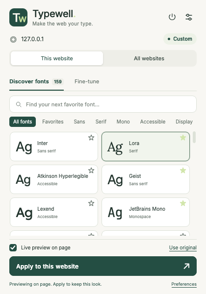

# Typewell — Font Changer for Firefox, Chrome, and Brave

Make the web your type. Typewell is an offline-first browser extension with a searchable font picker, temporary live previews, saved website rules, and a global default.

Built independently, inspired by the workflow of [Advanced Font Changer](https://chromewebstore.google.com/detail/advanced-font-changer/gaobdjbefgnnmnepikiadbdahmgajknm). It does not use that extension's source code or branding.



One shared codebase produces a Firefox add-on and a Chromium extension for Chrome, Brave, and compatible desktop browsers. See [TESTING.md](TESTING.md) for current verification and coverage limits.

Maintainers can publish updates to Firefox Add-ons and the Chrome Web Store by publishing a GitHub release. See the [release setup and publishing guide](docs/RELEASING.md) for account configuration and the coordinated release process.

## Try it in Chrome or Brave

Use a current desktop browser based on **Chromium 114 or newer**. The same Chromium build works in both Chrome and Brave.

1. Run `npm ci --ignore-scripts` if dependencies are not installed, then `npm run build:chromium`.
2. Open `chrome://extensions` in Chrome or `brave://extensions` in Brave.
3. Enable **Developer mode**, click **Load unpacked**, and select this project's **`dist/chromium`** folder.
4. Open a regular website and click **Typewell — Font Changer** in the extensions menu. Pick a font, preview it, then click **Apply to this website**.

Keep the unpacked folder in place while the extension is installed. After source changes, rebuild and click **Reload** on the extensions page, then refresh website tabs. Existing website tabs can also initialize the engine when you first open Typewell.

The build also creates **`dist/typewell-1.2.3-chromium.zip`**. To share it for local installation, extract it and load the folder containing `manifest.json`. This is a local development build; generating it does not submit or publish a Chrome Web Store release. See [the submission record](store/chrome/submission.txt) for the last observed portal state, and check the developer dashboard for current status. For Edge and other Chromium browsers, use their extensions page and the same unpacked folder; those browsers have not been individually tested.

Firefox and Chromium keep separate preferences. Use **Preferences → Export settings** in one browser and **Import a backup** in the other to transfer your choices.

[Chrome: load an unpacked extension](https://developer.chrome.com/docs/extensions/get-started/tutorial/hello-world#load-unpacked) · [Brave: extension support](https://support.brave.app/hc/en-us/articles/360017909112-How-can-I-add-extensions-to-Brave)

## Try it in Firefox

Requires **Firefox Desktop 142 or newer**. No build step or npm installation is needed to try the files already in this project.

1. Open `about:debugging#/runtime/this-firefox` in Firefox.
2. Click **Load Temporary Add-on…** and select **`extension/manifest.json`** from this project.
3. Open a regular website. Click the extensions puzzle piece, then **Typewell — Font Changer**. You can pin it to the toolbar from that menu.
4. Pick a font. With **Live preview on page** enabled, the website changes as you try fonts. Click **Apply to this website** to keep your choice.

Closing the popup discards unsaved previews. The shortcut is **Alt+Shift+F** (Option+Shift+F on Mac); Firefox lets you customize extension shortcuts in `about:addons`.

Temporary add-ons are removed when Firefox restarts. Export your settings from Preferences before removing a temporary installation. For installation that survives a restart, the extension needs a **Mozilla-signed XPI**. The generated `dist/typewell-1.2.3.xpi` is an **unsigned development package**, not a signed release. Mozilla supports both public AMO listings and private/unlisted signing; no public listing is required for personal distribution. Do not disable Firefox's signature checks.

[Mozilla: temporary installation](https://extensionworkshop.com/documentation/develop/temporary-installation-in-firefox/) · [Mozilla: signing and distribution](https://extensionworkshop.com/documentation/publish/signing-and-distribution-overview/)

## What's included

- **159 font choices:** 147 bundled fonts and 12 system-font choices, plus any installed font by family name.
- Search, category filters, favorites, and previews of every typeface.
- System, Light, and Dark interface themes. System follows the browser and operating system automatically.
- Inter, Geist, Poppins, Lora, Literata, JetBrains Mono, Fira Code, Lexend, OpenDyslexic, Atkinson Hyperlegible, and many more.
- Per-website settings and an optional global default. Site rules take priority.
- Font-size scaling from 75–175%, optional line height, letter spacing, and word spacing.
- A reading-content mode and optional preservation of code fonts.
- Common icon-font and generated-icon protection. Rich-text editors retain their own fonts, except Notion document text so Typewell works on Notion pages.
- Batched updates for dynamic page content, permitted iframes, and discovered open shadow roots.
- Instant restore, website exclusions, and a global pause switch.
- A preferences page with website-rule management and JSON backup/import.
- All fonts and settings stay local. No account, analytics, remote scripts, or font CDN requests while browsing.

## How preferences work

| Action | Result |
| --- | --- |
| Apply to this website | Save a rule for the exact hostname, across all its pages. |
| All websites → Set as my default | Use that profile wherever no website rule exists. |
| This website → Use original | Temporarily preview the page's original fonts. Click Apply to save it; if a global default exists, this saves an exclusion. |
| All websites → Clear default | Remove the global font; retain website rules and exclusions. |
| Preferences → Remove rule | Let that hostname follow the global default again. |
| Pause Typewell | Restore page fonts everywhere without deleting preferences. |
| Close an unsaved preview | Restore the current saved profile immediately. |

`example.com` and `www.example.com` are separate hosts. Schemes, ports, and paths do not create different rules. Embedded frames use the **top-level site's** rule, including cross-origin frames for which the browser grants access. Global previews affect the current tab; saving the global default updates other permitted tabs.

## Font coverage and practical limits

- The bundled files are **Latin-subset, regular (400), upright fonts**. The browser synthesizes bold and italic when requested by the website. Other scripts and missing glyphs fall back to the selected generic/system font. The catalog includes OpenDyslexic, Inclusive Sans, Readex Pro, and Atkinson Hyperlegible. It does not currently bundle full CJK/Arabic/Indic subsets.
- System and custom fonts must be installed and visible to the browser. Otherwise, the browser uses the fallback. Firefox's fingerprinting protections may limit local font access.
- Browsers block extensions on internal pages (`about:`, `chrome:`, `brave:`, and similar), built-in PDF viewers, other extensions' pages, and extension stores. Firefox also restricts certain Mozilla domains. File URLs are outside this extension's permission scope.
- Common icon-font names, icon classes, private-use glyphs, and icon pseudo-elements are protected. Unusual site-specific icon implementations can need additional rules. Canvas text and closed shadow roots cannot be restyled by this engine.
- Open shadow roots are discovered during page scans and DOM updates. A shadow root attached later to an otherwise unchanged host might require reloading the page. User-origin CSS applies in the document; the open-shadow-root fallback uses an author stylesheet, so an inline `!important` rule inside a shadow root may win.
- Page structure, colors, and font weights are retained. Different fonts and spacing naturally change line wrapping and can affect tightly constrained layouts. Use the original-font option on sites where you prefer their formatting.
- Grant Typewell access to the websites you want to customize. A missing-access banner in the popup can request all HTTP/HTTPS websites again after access is revoked.
- Private browsing and incognito windows are not supported in this release. The manifest prevents Typewell from accessing them, so private-session website rules cannot be saved.

## Development

Node.js 22 or newer is recommended. The extension itself is plain JavaScript, HTML, and CSS, with **no runtime dependencies or bundler**.

```sh
npm ci --ignore-scripts
npm test
npm run lint
npm run build          # Firefox ZIP and unsigned XPI
npm run build:chromium # Chromium ZIP and unpacked folder
# Or build both with: npm run build:all
```

The build verifies every bundled font's SHA-256 and license, then produces the selected browser artifacts in `dist/`. The default `npm run build` command still builds Firefox; Chromium uses a generated manifest with a service worker and PNG toolbar icons. Font binaries and licenses are checked into the source, so normal builds do not download fonts. `npm run fonts` reuses assets that still match their recorded hashes and licenses; new catalog entries are downloaded from Fontsource and pinned in `extension/fonts/sources.json`. Review asset and license changes before redistribution.

For Mozilla reviewers: the release was packaged on macOS 27 with Node.js 22.22.3. Install Node.js 22 LTS from [nodejs.org](https://nodejs.org/en/download), which includes npm, then use the commands above. The build uses only portable Node.js APIs and Mozilla web-ext; Firefox is needed only for the separate integration tests. Compare extracted XPI file contents, since ZIP metadata can differ. `scripts/fetch-fonts.mjs` is the original asset generator: it fetches pinned, unmodified Fontsource binaries/licenses and generates `extension/fonts/sources.json` and the readable `extension/ui/fonts.css` declarations. These generated assets are included for an offline reproduction of this release. To regenerate only the CSS without downloading anything, run `node scripts/generate-font-css.mjs` before `npm run build`.

`npm start` runs Mozilla's `web-ext` development launcher. On macOS 27, Firefox has a [known direct-launch problem](https://bugzilla.mozilla.org/show_bug.cgi?id=2060476); loading the temporary add-on through Firefox's UI avoids that launcher issue.

### Real Firefox integration tests

Install [Mozilla geckodriver](https://github.com/mozilla/geckodriver/releases) for your OS, then provide its executable path:

```sh
GECKODRIVER=/path/to/geckodriver npm run test:firefox
```

Set `FIREFOX_BINARY` for a non-default Firefox executable. On macOS, `FIREFOX_APP` can override `/Applications/Firefox.app`; the test runner uses LaunchServices with a **new temporary profile** to work around the macOS 27 issue. `FIREFOX_DIRECT_LAUNCH=1` selects ordinary geckodriver startup instead. The test server only binds to loopback, and the test suite does not use your regular browser profile.

Set `TYPEWELL_TEST_LIVE_GITHUB=1` to include an optional public GitHub file check. It uses a disposable profile without signing in and requires network access.

The suite installs the actual extension and checks font loading under a restrictive CSP, CSS override behavior, typography preservation, code/icons/editors, Google icon-family and generated-icon protection, GitHub file-view code preservation, Notion editor compatibility, frames, dynamic content, size scaling, profile precedence, preview cleanup, pause/resume, and preferences UI. Screenshots and a machine-readable result file are written to `test-results/`.

### Real Chromium integration tests

Build the Chromium extension, then run:

```sh
npm run build:chromium
npm run test:chromium
```

Set `CHROMIUM_BINARY` to a **Chrome for Testing**, Brave, or Chromium executable to select a browser; set `CHROMEDRIVER` to its matching ChromeDriver executable if it is not available through Selenium Manager. The automated suite needs a browser that accepts the extension-loading command-line flag. Recent standard Chrome builds require the manual **Load unpacked** installation described above instead. [Chromium explains this testing restriction](https://groups.google.com/a/chromium.org/g/chromium-extensions/c/1-g8EFx2BBY/m/S0ET5wPjCAAJ). Tests use a disposable browser profile and a loopback fixture server. They do not modify your usual browser profile. Selenium Manager may need network access to obtain a matching driver. **OpenSSL** must also be installed: the Notion-host regression uses a local HTTPS fixture with a temporary certificate trusted only in the disposable test profile.

The suite exercises the real service worker, font engine, preferences page, and toolbar popup, including recovery after the service worker stops. Results and screenshots go into `test-results/`.

## Project layout

```text
extension/
  manifest.json         Firefox Manifest V3 entry point
  background-worker.js  Chromium service-worker entry point
  background.js         Serialized settings writes and per-frame user CSS
  shared/               Browser API adapter, font catalog, settings validation, CSS generation
  content/              Page engine and temporary-preview lifecycle
  popup/                Font picker and readability controls
  options/              Preferences, website rules, backup/import
  fonts/                Bundled WOFF2 assets, licenses, source hashes
  ui/                   Shared styles and local font declarations
tests/                  Model/asset/build checks and Firefox/Chromium integration suites
scripts/                Asset fetcher, browser manifest generator, package builder
```

The content engine loads a bundled font as a binary `FontFace`, then marks text elements and asks the background script to insert **user-origin CSS**. This overrides author `!important` font rules without rewriting page content. Existing computed sizes are measured before applying overrides, so percentages preserve heading hierarchy and do not accumulate during DOM updates. Mutation work is batched, and protected glyphs retain their original font and size. Closing a preview connection restores the persisted settings. Chromium uses a small API adapter to keep asynchronous message responses compatible with older Chrome versions. A heartbeat runs only while the popup is open to keep its preview session alive; settings are read from local extension storage after a service worker restart.

## Privacy and licensing

See [PRIVACY.md](PRIVACY.md). Font-specific license files and source hashes are included in `extension/fonts/`. Original extension code is MIT licensed; individual fonts retain their own licenses.

## Mozilla Add-ons submission

Version **1.0.0 was submitted to Mozilla on September 13, 2026** as the initial release. Its submitted XPI and source archive remain preserved.

Version **1.1.0 was submitted and approved by Mozilla on September 18, 2026**. It is now the listed AMO version and adds 28 fonts. Mozilla's validation reports **0 errors and 0 warnings**. The preserved 1.0.0 XPI and source archive remain unchanged.

Version **1.1.1 was prepared for submission**. It makes **Use original** a temporary live preview until **Apply to this website** is clicked. This workspace does not yet record its final AMO portal status.

Version **1.2.0 is prepared locally and has not been uploaded**. It adds System, Light, and Dark themes to the popup and Preferences page, and removes the redundant popup sample so more fonts are visible.

Version **1.2.1 was prepared locally for submission**. It fixes font changes on Notion pages while continuing to protect editable regions on other websites. This workspace does not record its final AMO portal status.

Version **1.2.2 was prepared locally for submission**. This workspace does not record its final AMO portal status. It protects Google icon fonts and generated icons from typography overrides, including icons inside dynamically opened menus.

Version **1.2.3 is prepared locally and has not been uploaded**. It fixes code preservation in modern and legacy GitHub file views while retaining your chosen font for surrounding text. In addition to the fixture suite, the fix was verified on a public GitHub file.

See [store/README.md](store/README.md) and [store/submission.json](store/submission.json) for the verified submission record. The local XPI remains the unsigned upload. `npm run package:amo` prepares future release artifacts, but overwrites files in `dist/`; preserve the recorded upload and source archive when preparing a later version.
